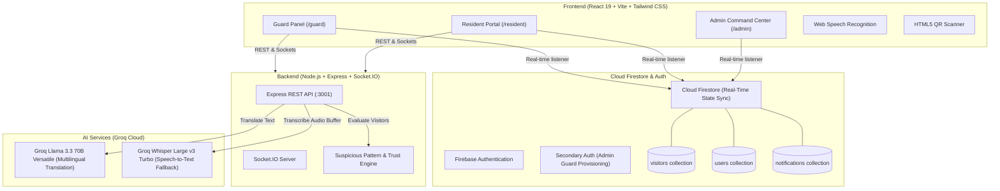

# 🛡️ SecureGate

> **Next-Gen AI-Powered Apartment & Gated Community Visitor Security Platform**  
> *Developed for Quantum Hacks • Powered by Real-Time Telemetry, Groq Llama 3.3, Whisper & Firebase*

[](https://react.dev/)
[](https://vitejs.dev/)
[](https://tailwindcss.com/)
[](https://nodejs.org/)
[](https://firebase.google.com/)
[](https://groq.com/)
[](https://socket.io/)

---

## 📌 Table of Contents

- [Overview](#-overview)
- [The Problem It Solves](#-the-problem-it-solves)
- [Key Features](#-key-features)
  - [Role-Based Portals](#1-role-based-portals)
  - [AI Suspicious Pattern & Trust Engine](#2-ai-suspicious-pattern--trust-engine)
  - [Multilingual Conversational AI & Voice Chat](#3-multilingual-conversational-ai--voice-chat)
  - [Contactless Digital QR Passes](#4-contactless-digital-qr-passes)
  - [Visual Analytics & Society Heatmaps](#5-visual-analytics--society-heatmaps)
- [System Architecture](#-system-architecture)
- [Repository Structure](#-repository-structure)
- [Getting Started](#-getting-started)
  - [Prerequisites](#prerequisites)
  - [1. Clone Repository](#1-clone-repository)
  - [2. Backend Setup](#2-backend-setup)
  - [3. Frontend Setup](#3-frontend-setup)
- [Environment Variables](#-environment-variables)
- [User Roles & Demo Workflow](#-user-roles--demo-workflow)
- [API Reference](#-api-reference)
- [Contributing & License](#-contributing--license)

---

## 🌟 Overview

**SecureGate** is an enterprise-grade gated community security and visitor management system designed to eliminate gate friction, verify visitor identities, prevent unauthorized entries, and bridge the linguistic gap between on-duty security personnel and residents.

Built with **React 19**, **Vite**, **Tailwind CSS v4**, **Node.js/Express**, **Socket.IO**, and **Firebase Firestore**, SecureGate features real-time synchronization, AI behavioral risk telemetry via **Groq Llama 3.3 70B**, automated visitor trust scoring, speech-to-text voice recognition, and contactless QR scanning.

---

## 🎯 The Problem It Solves

| Traditional Gate Challenges | SecureGate Solution |
| :--- | :--- |
| **Language Barriers:** Guards often speak local dialects while residents speak English or other regional languages. | **AI Multilingual Engine:** Instant bidirectional translation between English, Hindi (हिंदी), and Marathi (मराठी) powered by Llama 3.3 70B and Web Speech API. |
| **Fake Entries & Identity Spoofing:** Paper logs allow fake names, dummy phone numbers, and untracked entries. | **Identity & Trust Telemetry:** +91 phone validation, camera photo check, facial match verification, and a 0–100 dynamic trust score. |
| **Door-to-Door Intrusion:** Unauthorized salespeople or canvassers roam freely across multiple flats. | **Behavioral Pattern Engine:** Real-time multi-flat alerts when one phone number targets $\ge 3$ distinct apartments in a single day. |
| **Gate Bottlenecks & Queues:** Manual intercom calling delays visitor approval. | **Instant Sync & Pre-Approved QR Passes:** Firestore listeners deliver sub-second notifications; residents can pre-approve guests with downloadable QR passes. |
| **Lack of Oversight:** Society management has zero visibility into gate telemetry or repeat security threats. | **Admin Command Center:** Recharts analytics, peak hour traffic breakdowns, society-level entry heatmaps, and one-click Excel audit logs. |

---

## 🚀 Key Features

### 1. Role-Based Portals

SecureGate provides three dedicated, authenticated interfaces:

- 🛡️ **Security Guard Panel (`/guard`)**
  - **Live Gate Feed:** Monitor pending, approved, and checked-in visitors in real time.
  - **Fast Walk-in Registration:** Capture visitor name, purpose (Guest, Delivery, Cab, Service, Other), flat number, phone number, and photo via camera stream.
  - **QR Code Scanner:** Built-in camera scanner (`html5-qrcode`) for contactless validation of pre-approved digital passes.
  - **Instant Check-in & Check-out:** Time-stamped entry and exit tracking with one click.
  - **Direct Resident Chat:** Interactive voice/text chat modal with instant AI translation to clear visitor ambiguity.

- 🏠 **Resident Portal (`/resident`)**
  - **Approval Queue:** Receive instant push notifications for arriving visitors; Accept, Reject, or Block with a single tap.
  - **Pre-Approved Digital Passes:** Generate timed entry passes for expected guests, workers, or delivery agents with downloadable PNG QR codes.
  - **Visitor History & Excel Export:** Searchable past records with date/status filters and full `.xlsx` spreadsheet exports.
  - **Security & Blocklist:** View blocked visitors, block repeat offenders, and configure flat security settings.
  - **Multilingual Chat:** Communicate directly with the gate guard with automatic real-time translation.

- 👑 **Society Admin Command Center (`/admin`)**
  - **Live Security Telemetry:** Overview of total entries, active visitors on premises, registered guards, and unhandled security anomalies.
  - **Resident KYC Verification:** Review, approve, or reject new resident registrations before granting portal access.
  - **Guard Roster Management:** Register and provision security guards across specific gate posts with dual-session Firebase authentication.
  - **Society Heatmap:** Visual geographic heatmap indicating entry frequency by wing, gate, and flat.
  - **Interactive Analytics:** Visual graphs (Recharts) covering peak visitor hours, entry categories, and status distributions.
  - **Society-wide Audit Logs:** Search, filter, and export visitor records for administrative reporting.

---

### 2. AI Suspicious Pattern & Trust Engine

SecureGate continuously analyzes visitor activity to compute threat vectors:

```
                                  ┌──────────────────────────────┐
                                  │  Visitor Entry Request       │
                                  └──────────────┬───────────────┘
                                                 │
                                                 ▼
                 ┌──────────────────────────────────────────────────────────────┐
                 │          Suspicious Pattern Detection Pipeline               │
                 ├──────────────────────────────────────────────────────────────┤
                 │  [Pattern 1] Multi-Flat Activity (>2 flats in 24 hours)      │
                 │  [Pattern 2] Repeated Rejections (>= 2 rejections in 7 days) │
                 │  [Pattern 3] Late-Night Entry Attempt (12:00 AM - 05:00 AM)  │
                 │  [Pattern 4] Face Mismatch / Identity Contradiction          │
                 │  [Pattern 5] Low Trust Score (< 40)                          │
                 └──────────────────────────────┬───────────────────────────────┘
                                                 │
                        ┌────────────────────────┴────────────────────────┐
                        ▼                                                 ▼
             [Clean / Low Risk]                              [Flagged Anomalies]
             • Standard Approval Queue                       • High-Priority Alert to Admin
             • Trust Score Boost (+10)                       • Warning Badge on Guard Panel
                                                             • Trust Score Deduction (-15 to -30)
```

- **Dynamic Trust Score (0–100):**
  - Base score: `50`
  - Successful approved visit & checkout: `+10`
  - Flat rejection: `-15`
  - Face mismatch / credential failure: `-30`

---

### 3. Multilingual Conversational AI & Voice Chat

Guards and residents often converse in different languages. SecureGate bridges this with real-time translation and voice input:

- **AI Translation Powered by Groq Llama 3.3 70B:**
  - Zero-latency translation between **English**, **Hindi (Devanagari script)**, and **Marathi (Devanagari script)**.
  - Preserves proper nouns, flat numbers, and mobile numbers without mistranslation.
  - Informal, conversational tone tailored for Indian security context.
- **Hands-Free Speech-to-Text:**
  - Browser-native Web Speech API (`SpeechRecognition`) supporting English (India), Hindi, and Marathi.
  - Server fallback utilizing **Groq Whisper Large v3 Turbo** with in-memory buffer streaming (zero disk I/O).

---

### 4. Contactless Digital QR Passes

Residents can generate digital gate passes for expected guests:
- Generates a unique secure pass ID and payload with resident details, flat number, and time bounds.
- Real-time QR generation using `qrcode.react` with instant **PNG download** and share capability.
- Security guards scan the QR pass using the gate camera scanner (`html5-qrcode`) for instant contactless check-in.

---

### 5. Visual Analytics & Society Heatmaps

- **Peak Entry Hours:** Area charts illustrating daily visitor traffic trends to help plan guard shifts.
- **Visitor Category Breakdown:** Pie & bar charts comparing Delivery, Guests, Service personnel, and Cabs.
- **Society Flat Heatmap:** Identify high-traffic flats and wings to optimize delivery parcel drop zones and security patrols.

---

## 🏗️ System Architecture



---

## 📂 Repository Structure

```
QuantumHack/
├── client/                              # React 19 + Vite Frontend
│   ├── public/                          # Static assets and icons
│   ├── src/
│   │   ├── components/
│   │   │   └── VisitorChatModal.jsx     # Multilingual voice/text chat modal
│   │   ├── data/
│   │   │   └── mockData.js              # Mock visitor telemetry & initial seed data
│   │   ├── pages/
│   │   │   ├── AdminDashboard.jsx       # Admin analytics, KYC verification & roster
│   │   │   ├── CompleteProfile.jsx      # Post-signup role & flat assignment
│   │   │   ├── GuardDashboard.jsx       # Guard walk-in entry, QR scan & live logs
│   │   │   ├── Login.jsx                # Multi-role authentication & registration
│   │   │   └── ResidentDashboard.jsx    # Approvals, QR pass generation & history
│   │   ├── utils/
│   │   │   ├── notificationHelpers.js   # Firestore notifications & guard alerts
│   │   │   ├── phoneValidation.js       # Indian phone (+91) format & uniqueness check
│   │   │   └── visitorHelpers.js        # Visitor state transitions & queries
│   │   ├── App.jsx                      # Protected routing & role guards
│   │   ├── firebase.js                  # Primary & secondary Firebase initialization
│   │   ├── index.css                    # Design system, glassmorphism & gradients
│   │   └── main.jsx                     # Application bootstrap
│   ├── package.json
│   └── vite.config.js
│
├── server/                              # Node.js + Express Backend
│   ├── services/
│   │   └── suspiciousDetector.js        # Pattern detection & trust score algorithm
│   ├── index.js                         # API routes, Groq AI integrations, Sockets
│   ├── package.json
│   └── .env                             # Server environment variables
│
├── .gitignore                           # Git ignore rules
└── README.md                            # Project documentation
```

---

## ⚙️ Getting Started

### Prerequisites

Ensure you have the following installed on your machine:
- **Node.js** (v18.0.0 or later)
- **npm** (v9.0.0 or later)
- A **Firebase Project** with Authentication (Email/Password & Google) and Cloud Firestore enabled
- A **Groq Cloud API Key** (Get one at [console.groq.com](https://console.groq.com/))

---

### 1. Clone Repository

```bash
git clone https://github.com/Anups05/QuantumHack.git
cd QuantumHack
```

---

### 2. Backend Setup

1. Navigate to the `server` directory:
   ```bash
   cd server
   ```

2. Install dependencies:
   ```bash
   npm install
   ```

3. Create a `.env` file in `server/`:
   ```env
   PORT=3001
   GROQ_API_KEY=your_groq_api_key_here
   ```

4. Start the backend server:
   ```bash
   # Development mode with auto-reload
   npm run dev

   # Or standard start
   npm start
   ```
   *The backend will run on `http://localhost:3001`.*

---

### 3. Frontend Setup

1. Open a new terminal and navigate to the `client` directory:
   ```bash
   cd client
   ```

2. Install dependencies:
   ```bash
   npm install
   ```

3. Create a `.env` file in `client/`:
   ```env
   VITE_FIREBASE_API_KEY=your_firebase_api_key
   VITE_FIREBASE_AUTH_DOMAIN=your_project.firebaseapp.com
   VITE_FIREBASE_PROJECT_ID=your_project_id
   VITE_FIREBASE_STORAGE_BUCKET=your_project.appspot.com
   VITE_FIREBASE_MESSAGING_SENDER_ID=your_messaging_sender_id
   VITE_FIREBASE_APP_ID=your_app_id
   VITE_SERVER_URL=http://localhost:3001
   ```

4. Launch the Vite development server:
   ```bash
   npm run dev
   ```
   *The client will run on `http://localhost:5173`.*

---

## 🔐 Environment Variables

### Backend (`server/.env`)

| Variable | Description | Default |
| :--- | :--- | :--- |
| `PORT` | Port number for Express & Socket.IO server | `3001` |
| `GROQ_API_KEY` | Groq API Key for Llama 3.3 translation & Whisper transcription | *Required* |

### Frontend (`client/.env`)

| Variable | Description |
| :--- | :--- |
| `VITE_FIREBASE_API_KEY` | Firebase Web API key |
| `VITE_FIREBASE_AUTH_DOMAIN` | Firebase Authentication domain |
| `VITE_FIREBASE_PROJECT_ID` | Firebase Project ID |
| `VITE_FIREBASE_STORAGE_BUCKET`| Firebase Cloud Storage bucket URL |
| `VITE_FIREBASE_MESSAGING_SENDER_ID` | Firebase Cloud Messaging sender ID |
| `VITE_FIREBASE_APP_ID` | Firebase Web App ID |
| `VITE_SERVER_URL` | Base URL pointing to the SecureGate backend |

---

## 👥 User Roles & Demo Workflow

To test all capabilities end-to-end:

### Scenario 1: Visitor Arrival & Approval
1. **Guard Logs Entry:** Login as a **Security Guard** (`/guard`). Navigate to **New Entry**, select Flat (e.g. `A-302`), enter visitor name, phone number (`+919876543210`), capture/upload a photo, and submit.
2. **Resident Receives Alert:** In another browser window, login as the **Resident** of `A-302` (`/resident`). The pending visitor appears instantly in the **Approvals** tab.
3. **Multilingual Chat:** Open the chat window on both screens. Guard sends a message in Hindi or Marathi; the resident reads it translated into English in real time!
4. **Approve / Check-in:** Resident clicks **Approve**. The Guard Dashboard updates in real time to show **Approved**, enabling the guard to check in the visitor.

### Scenario 2: Pre-Approved QR Gate Pass
1. **Resident Generates Pass:** As a resident, go to the **Passes** tab, click **New Pass**, provide visitor details and validity, and click **Create**.
2. **Download Pass:** Download the generated QR code PNG.
3. **Guard Scans Pass:** Switch to the guard portal, open the **Scan QR** tab, and hold the QR code to the webcam to trigger immediate check-in.

### Scenario 3: Admin Audits & Suspicious Behavior Detection
1. **Trigger Anomaly:** Attempt to log entries using the same phone number for multiple different flats within minutes.
2. **View Real-Time Alerts:** Login as **Society Admin** (`/admin`). The top notification bell flags a **Suspicious Multi-Flat Activity** alert.
3. **Inspect Telemetry:** Review the society entry heatmap, download the visitor log as an Excel sheet (`.xlsx`), and inspect the visitor's trust rating.

---

## 📡 API Reference

### Health Check
- `GET /api/health`
  - Returns backend status and timestamp.

### Translation (Groq Llama 3.3 70B)
- `POST /api/chat/translate`
  - **Body:** `{ "text": "Visitor at the main gate for Flat B-201", "targetLang": "hi" }`
  - **Supported `targetLang`:** `en` (English), `hi` (Hindi), `mr` (Marathi)
  - **Response:** `{ "translated": "फ्लैट B-201 के लिए मुख्य गेट पर आगंतुक हैं", "original": "...", "targetLang": "hi" }`

### Audio Transcription (Groq Whisper Large v3 Fallback)
- `POST /api/chat/transcribe`
  - **Payload:** `multipart/form-data` with `audio` stream buffer.
  - **Response:** `{ "text": "transcribed speech content" }`

### Socket.IO Real-time Events
- `join:room` — Join a guard or visitor chat room.
- `chat:message` — Broadcast two-way message between guard and resident.
- `visitor:approve` / `visitor:reject` — Real-time event notifications for gate guards.
- `emergency:alert` — Broadcast urgent community security alerts.

---

## 🤝 Contributing

Contributions, issues, and feature suggestions are welcome!
1. Fork the Project.
2. Create your Feature Branch (`git checkout -b feature/AmazingFeature`).
3. Commit your Changes (`git commit -m 'Add some AmazingFeature'`).
4. Push to the Branch (`git push origin feature/AmazingFeature`).
5. Open a Pull Request.

---

## 📄 License

Distributed under the **MIT License**. See `LICENSE` for more information.

---

<p align="center">
  Built with ❤️ for <b>Quantum Hacks</b>
</p>

